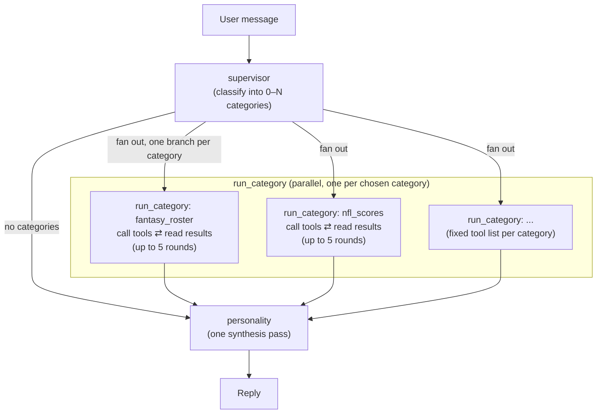

# LangGraph Workflow

`fantasy_agent/graphs/graph.py` builds a bounded pipeline for every
message: figure out what's being asked, go fetch the data for it (in
parallel if more than one topic applies), then write one reply. It's not a
free-form network of agents chatting with each other — each step runs
exactly once (the data-fetching step once per topic) and tool calls are
hard-capped. That keeps things predictable and stops the graph from ever
looping forever.



## Node functions: chat graph (`fantasy_agent/graphs/graph.py`)

#### `supervisor_node(state) -> {categories, reasoning}`
```python
choice = invoke_llm(..., with_structured_output(CategoryChoice))  # {reasoning, categories}
valid = [c for c in choice.categories if c in CATEGORY_REGISTRY]
return {"categories": valid, "reasoning": choice.reasoning}
```
- Runs once. Classifies the message into 0–N categories from `CATEGORY_REGISTRY`
  (`fantasy_*` = private league, `nfl_*` = real-world data). Never calls a tool.
- Invalid category names the model invents are dropped silently.

#### `route_to_categories(state) -> "personality" | list[Send]`
```python
if not state["categories"]:
    return "personality"
return [Send("run_category", {"messages": ..., "category": c, "reasoning": ...}) for c in state["categories"]]
```
- Conditional edge (not a node). Fans out one `run_category` branch per category, or skips to `personality` if none were picked.

#### `run_category_node(state) -> {messages}`
```python
tools = CATEGORY_REGISTRY[category]
for _ in range(MAX_TOOL_ROUNDS):          # MAX_TOOL_ROUNDS = 5
    response = invoke_llm(..., bind_tools(tools))
    if not response.tool_calls:
        break
    for tc in response.tool_calls:
        ...  # tool_node.invoke, append result to `local`
return {"messages": local}
```
- Runs once per chosen category, in parallel. Each instance is bound only to
  `CATEGORY_REGISTRY[category]` - its own category's tools, not every tool -
  so the fan-out both parallelizes and restricts the work.
- Loops up to `MAX_TOOL_ROUNDS`; stops early once the model replies with no tool calls.
- Hard rule in its prompt: call tools only, never answer — that's `personality`'s job.

#### `personality_node(state) -> {messages}`
```python
full_text = _chunk_text(invoke_llm(_llm, context))
if not full_text.strip():
    full_text = "Sorry, I didn't quite catch that - could you rephrase?"
return {"messages": [AIMessage(content=full_text)]}
```
- Runs once; the only node the user sees output from. One model call, grounded strictly in this turn's tool results.
- A checklist message lists which categories actually ran, so the model can't claim data "wasn't pulled."
- Falls back to a fixed apology line if the model returns empty text.
- `personality -> END`: the graph ends here. There is no review/retry step.

## Node functions: weekly recap graph (`fantasy_agent/graphs/weekly_recap_graph.py`)

`START -> get_matchups -> league_summary -> power_ranking_image -> END`, all nodes run exactly once.

#### `get_matchups_node(state) -> {week, matchups}`
```python
week = state.get("week") or nfl_game_week()
box_scores = league_singleton().box_scores(week=week)
return {"week": week, "matchups": [{"home_team", "away_team", "home_score", "away_score"}, ...]}
```
- Fetches the week's final box scores; defaults to the current NFL week.

#### `league_summary_node(state) -> {league_summary, power_rankings}`
```python
result = invoke_llm(_llm, [system, prompt])  # with_structured_output(WeeklySummaryOutput)
return {"league_summary": result.league_summary.strip(), "power_rankings": [...]}
```
- One model call turns this week's scores + current standings into recap beats and a ranked, tagged list of every team.

#### `power_ranking_image_node(state) -> {power_ranking_image}`
```python
try:
    image_bytes = generate_image(prompt, size="1536x1024")
except Exception as err:
    emit("node_error", node="power_ranking_image", error=str(err))
return {"power_ranking_image": image_bytes}
```
- Renders the poster graphic from the matchups + power rankings. On failure, leaves the image `None` instead of raising.

## Node functions: matchup preview graph (`fantasy_agent/graphs/matchup_preview_graph.py`)

`START -> get_matchup_data -> flag_lineup_changes -> matchup_preview -> matchup_image -> END`, all nodes run exactly once.

#### `get_matchup_data_node(state) -> {week, matchups}`
```python
box_scores = league.box_scores(week=week)
return {"week": week, "matchups": [{"team_a", "proj_a", "record_a", "team_b", "proj_b", "record_b", "winner", "margin"}, ...]}
```
- Builds each matchup's projections, records, and projected winner/margin from box scores + standings.

#### `flag_lineup_changes_node(state) -> {lineup_flags}`
```python
duds = [p for p in last_week_lineup if p.slot_position not in BENCH_SLOTS and not p.on_bye_week and p.points == 0]
# then check this week's roster/starters to classify each dud as dropped/benched/still-starting
return {"lineup_flags": {team: [{"player", "status", "injury_status"?}, ...]}}
```
- Flags last week's zero-point starters and tags each as `dropped/traded away`, `benched`, or `still starting despite the zero`.

#### `matchup_preview_node(state) -> {league_preview, matchups}`
```python
result = invoke_llm(_llm, [system, prompt])  # with_structured_output(MatchupPreviewOutput)
return {"league_preview": result.league_preview.strip(), "matchups": state["matchups"]}
```
- One model call writes one joke beat per matchup, folding in `lineup_flags` and, if present, last week's recap as callback color.

#### `matchup_image_node(state) -> {matchup_image}`
```python
for attempt in range(1, attempts + 1):   # attempts = 2
    try:
        image_bytes = generate_image(prompt, size="1536x1024")
        break
    except Exception as err:
        emit("node_error", node="matchup_image", error=str(err), attempt=attempt)
return {"matchup_image": image_bytes}
```
- Renders the scoreboard graphic; retries once on failure, leaves the image `None` if both attempts fail.

## Model and keys

Every node uses the same Gemini model (`FANTASY_AGENT_MODEL` env var,
default `gemini-3.7-flash`), just with different prompts/tools/settings per
node. Reasoning effort is `low` for `supervisor`, `high` for `personality`,
and `medium` for `run_category`. High effort on `personality` once caused
empty replies on off-topic turns, so re-verify that after prompt changes.

`invoke_llm()` wraps every model call with `GOOGLE_API_KEY`.

`personality` has one fallback of its own: if the model call comes back
with no text at all, it falls back to a fixed "Sorry, I didn't quite
catch that" instead of showing the user an empty message.

## State shape

`AgentState` (a `MessagesState` subclass) carries `messages` — the running
conversation, shared across every node — plus `categories` and `reasoning`,
which the supervisor sets and `run_category` reads, and a `category` field
naming which category a given parallel branch belongs to.

## Tracing

Every node calls `fantasy_agent/logging/trace.py`'s `emit()` around its work
(`node_start`/`node_end` pairs, plus `tool_call`/`tool_result` inside
`run_category`) rather than printing directly. `fantasy_agent/server.py` also
emits one `graph_end` event per request (graph name + total invoke duration
in ms) for the chat, weekly-recap, and matchup-preview graphs. `emit()` just
prints (`[trace] <event> <data>`) — it's a local log line, nothing consumes
these over the network. `tests/chat_audit.py` is the one place that reads
node-level events back, by temporarily monkeypatching `trace.emit` to also
capture events into its report.

## Adding a new data source

Add a `@tool`-decorated function to the right module under
`fantasy_agent/tools/` (or a new module, registered in
`fantasy_agent/tools/__init__.py`'s `_MODULES` dict, if it's a whole new
category). The supervisor and graph pick it up automatically from
`CATEGORY_REGISTRY`/`CATEGORY_DESCRIPTIONS` — `graph.py` itself doesn't
need to change. See [`NFL_PUBLIC_API.md`](./NFL_PUBLIC_API.md) and
[`FANTASY_ESPN_API.md`](./FANTASY_ESPN_API.md) for what each existing tool
calls.
